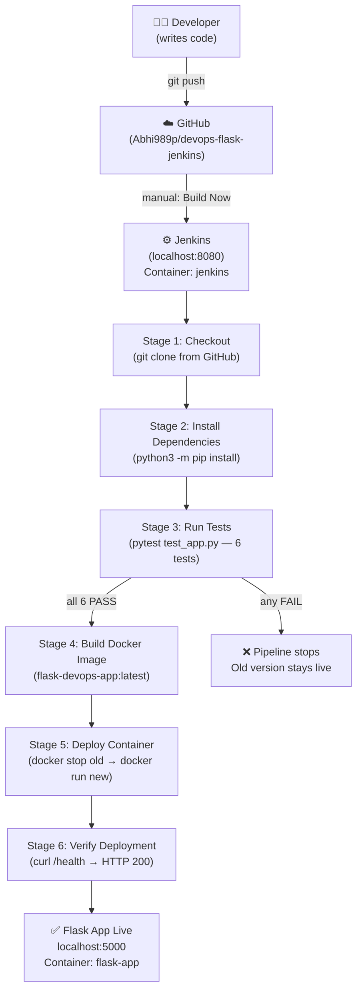

# Project Demonstration Guide
## Automated Deployment of Flask Applications using Jenkins and Docker

> **All instructions in this file are based on the actual running project —
> verified on 25 October 2026. No features are assumed or invented.**

---

## Part 1 — Understanding the Project

### 1.1 What Problem Does This Project Solve?

Imagine you are part of a team that builds a web application. Every time a
developer writes new code, someone has to:

1. Copy the code to a server manually.
2. Install the right Python packages.
3. Run tests to check for bugs.
4. Start the application.
5. Check that it is working.

This manual process is slow, error-prone, and inconsistent — different people
do it differently. If a test fails, you might not catch it until the bad code
is already live.

**This project automates every one of those steps.** A developer only has to
push code to GitHub. The rest — testing, building, and deploying — happens
automatically through a Jenkins pipeline.

---

### 1.2 What Is the Automated Solution?

When code is pushed to GitHub:

1. **Jenkins** detects the change (or you click Build Now).
2. Jenkins pulls the latest code.
3. Python dependencies are installed automatically.
4. Automated tests run. **If any test fails, deployment is cancelled.**
5. A Docker image of the application is built.
6. The old running container is stopped and replaced with the new one.
7. Jenkins checks the `/health` endpoint to confirm the new app is live.

The whole process takes about 30–60 seconds.

---

### 1.3 Why Each Technology Is Used

| Technology | Why Used |
|------------|----------|
| **Python Flask** | Lightweight web framework — easy to build REST endpoints quickly |
| **Git** | Tracks every change to the code locally |
| **GitHub** | Cloud-hosted storage for the code; Jenkins reads from it |
| **Docker** | Packages the app + its dependencies into a portable container |
| **Jenkins** | Automation server that runs the pipeline every time code changes |
| **Pytest** | Runs automated tests to catch bugs before deployment |

---

### 1.4 What Is CI/CD?

**CI = Continuous Integration** — Every code change is automatically tested.
Bugs are caught immediately, before they reach production.

**CD = Continuous Delivery/Deployment** — After tests pass, the application
is automatically built and deployed. No manual steps needed.

**This project demonstrates CI/CD** by:
- Automatically running 6 tests on every build (CI)
- Automatically rebuilding and redeploying the Docker container (CD)
- Automatically verifying the live app after deployment (CD)

---

### 1.5 Architecture Diagram



**ASCII fallback (if Mermaid is not rendered):**

```
Developer
    │
    │  git push
    ▼
GitHub (Abhi989p/devops-flask-jenkins)
    │
    │  Build Now (manual trigger)
    ▼
Jenkins (localhost:8080) ── Container: jenkins / Image: my-jenkins-docker
    │
    ├─ Stage 1: Checkout ──────────── pulls code from GitHub
    ├─ Stage 2: Install Dependencies ─ pip install flask pytest
    ├─ Stage 3: Run Tests ─────────── pytest (6 tests) ── FAIL → pipeline stops
    ├─ Stage 4: Build Docker Image ─── docker build flask-devops-app:latest
    ├─ Stage 5: Deploy Container ───── docker stop flask-app → docker run flask-app
    └─ Stage 6: Verify Deployment ──── curl http://host.docker.internal:5000/health
                                                │
                                                ▼
                                    Flask App (localhost:5000)
                                    Container: flask-app
                                    Image: flask-devops-app:latest
```

---

## Part 2 — Every File Explained

### `app.py` — The Flask Web Application

```python
from flask import Flask, jsonify

app = Flask(__name__)
APP_VERSION = "1.0.0"

@app.route("/")
def home():
    return "<html>...Flask DevOps Demo...Version: 1.0.0...</html>"

@app.route("/health")
def health():
    return jsonify({"status": "healthy", "version": APP_VERSION}), 200

if __name__ == "__main__":
    app.run(host="0.0.0.0", port=5000, debug=False)
```

**What it does:** Defines a web server with two URL endpoints.

**Why it is needed:** This is the actual application being deployed by the pipeline.

**`APP_VERSION`** — A string constant. Changing this value is how we
demonstrate re-deployment. Tests verify this value appears on both endpoints.

**`host="0.0.0.0"`** — Makes the server listen on all network interfaces,
not just localhost. This is required inside Docker so the container can
receive requests from outside.

**`/health` endpoint** — Returns a JSON response. Jenkins uses this in
Stage 6 to confirm the app is actually running after deployment.

**If missing:** Nothing to deploy. Jenkins Stage 1 checkout would succeed
but Stage 3 tests would fail immediately.

---

### `requirements.txt` — Python Dependencies

```
flask==3.0.3
pytest==8.3.2
```

**What it does:** Lists the exact Python packages and versions the project needs.

**Why it is needed:** Both Jenkins (Stage 2) and Docker (Dockerfile line 11)
use this file to install dependencies. Pinning versions ensures the same
packages are used every time.

**If missing:** `pip install -r requirements.txt` fails in both Jenkins and
Docker. The pipeline would fail at Stage 2.

---

### `Dockerfile` — Docker Image Blueprint

```dockerfile
FROM python:3.11-slim          # Start from official Python 3.11 image
WORKDIR /app                   # Set /app as the working directory
COPY requirements.txt .        # Copy dependency list first (for layer caching)
RUN pip install --no-cache-dir -r requirements.txt  # Install packages
COPY app.py .                  # Copy application code
EXPOSE 5000                    # Document that port 5000 will be used
CMD ["python", "app.py"]       # Command to start the app
```

**What it does:** A recipe that Docker follows to build the application image.

**Layer caching trick:** `requirements.txt` is copied and installed BEFORE
`app.py`. This means if only `app.py` changes, Docker reuses the cached
layer with installed packages — making builds much faster.

**`FROM python:3.11-slim`** — Uses a minimal Python image (216 MB) instead
of the full image (~900 MB).

**`EXPOSE 5000`** — This is documentation only; the actual port mapping
happens in the `docker run -p 5000:5000` command in Stage 5 of the pipeline.

**If missing:** Stage 4 (Build Docker Image) would fail with
"no such file or directory: Dockerfile".

---

### `.dockerignore` — Docker Build Exclusions

```
__pycache__/    ← compiled Python bytecode, not needed in image
*.pyc           ← compiled Python files
.git/           ← Git history, not needed in image
venv/           ← local virtual environment
test_app.py     ← tests run in Jenkins, not in the container
Jenkinsfile     ← CI config, not needed in the running app
*.md            ← documentation files
```

**What it does:** Tells Docker which files NOT to include when building the
image. Only `app.py` and `requirements.txt` end up inside the final image.

**Why it is needed:** Keeps the Docker image small and clean. Without it,
Docker would copy the entire project (including .git history, test files,
documentation) into the image — wasting space and potentially exposing
sensitive files.

---

### `.gitignore` — Git Exclusions

```
__pycache__/    ← compiled Python bytecode
venv/           ← local virtual environment (can be 100s of MB)
.pytest_cache/  ← pytest temporary files
*.pyc           ← compiled Python files
.vscode/        ← personal IDE settings
```

**What it does:** Tells Git which files NOT to track or push to GitHub.

**Why it is needed:** Without it, `git add .` would upload the entire `venv`
folder (hundreds of megabytes) and generated cache files to GitHub.

---

### `Jenkinsfile` — The CI/CD Pipeline Definition

This file defines all 6 pipeline stages. Jenkins reads it directly from
GitHub on every build.

#### Environment Variables (lines 4–9)
```groovy
IMAGE_NAME     = "flask-devops-app"   // Docker image name
CONTAINER_NAME = "flask-app"          // Running container name
APP_PORT       = "5000"               // Port inside the container
HOST_PORT      = "5000"               // Port on the host machine
```
These are used throughout all stages. Changing `HOST_PORT` here changes
the port everywhere — no other edits needed.

#### Stage 1 — Checkout (lines 16–22)
```groovy
checkout scm
```
`scm` means "Source Control Management" — Jenkins automatically knows
the GitHub repo URL from the job configuration. It pulls the latest
commit from the `main` branch.

**If it fails:** Usually means GitHub is unreachable, or the repo URL
in the Jenkins job is wrong.

#### Stage 2 — Install Dependencies (lines 27–36)
```groovy
python3 -m pip install -r requirements.txt --break-system-packages --ignore-installed -q
python3 -m pip show flask pytest
```
- `--break-system-packages` — Required on Debian 12 (the Jenkins container's OS) to allow pip to install into the system Python.
- `--ignore-installed` — Skips packages already installed by the OS package manager (like pytest).
- `python3 -m pip show flask pytest` — Prints installed versions for confirmation in the build log.

**If it fails:** Requirements file is missing or has invalid package names.

#### Stage 3 — Run Tests (lines 41–46)
```groovy
python3 -m pytest test_app.py -v --tb=short
```
- `-v` — Verbose: shows each test name and PASSED/FAILED.
- `--tb=short` — Short traceback: shows just the failing assertion.

**This is the safety gate.** If any test fails (exit code ≠ 0), Jenkins
marks the stage as failed and **skips all remaining stages**. The old
container keeps running. Nothing is deployed.

#### Stage 4 — Build Docker Image (lines 51–58)
```groovy
docker build -t flask-devops-app:latest .
```
Builds a new Docker image from the Dockerfile and tags it `flask-devops-app:latest`.
Jenkins has access to Docker through the `/var/run/docker.sock` socket mount.

**If it fails:** Dockerfile is missing or has syntax errors.

#### Stage 5 — Deploy Container (lines 64–79)
```groovy
docker stop flask-app  2>/dev/null || true   # Stop old container (ignore error if none)
docker rm   flask-app  2>/dev/null || true   # Remove old container
docker run -d \
    --name flask-app \
    -p 5000:5000 \
    --restart unless-stopped \
    flask-devops-app:latest
```
- `|| true` — Prevents the pipeline from failing if no old container exists (first run).
- `-d` — Detached mode: runs in the background.
- `--restart unless-stopped` — Container automatically restarts if Docker Desktop restarts.

This stage makes re-deployment repeatable: every build replaces the
old container with the new one.

#### Stage 6 — Verify Deployment (lines 85–106)
```groovy
sleep 5   # Wait for container to fully start
HTTP_CODE=$(curl -s -o /tmp/health_response.txt -w "%{http_code}" \
    http://host.docker.internal:5000/health)

if [ "$HTTP_CODE" = "200" ]; then
    echo "Deployment verified successfully (HTTP 200)."
else
    exit 1   # Fail the pipeline
fi
```
`host.docker.internal` — A special DNS name that resolves to the Docker
host (your Windows machine) from inside any container. This is how Jenkins
(running in a container) reaches the Flask app (running in another container)
via the host's port 5000.

**If it fails:** The new container started but the app crashed on startup.

#### Post Actions (lines 109–116)
```groovy
post {
    success { echo "Pipeline completed successfully!..." }
    failure { echo "Pipeline failed. Check the stage logs..." }
}
```
Always runs after all stages. Prints a final summary message regardless
of whether the build passed or failed.

---

### `test_app.py` — Automated Test Suite

```python
@pytest.fixture
def client():
    app.config["TESTING"] = True
    with app.test_client() as client:
        yield client
```
**The `client` fixture** — Sets up a fake HTTP client for the Flask app.
Tests use this client to make requests without starting a real server.
`TESTING = True` disables Flask's error handling so exceptions show up clearly.

**The 6 tests:**

| Test | What It Checks |
|------|----------------|
| `test_home_status` | `GET /` returns HTTP 200 |
| `test_home_contains_version` | Homepage HTML contains `"1.0.0"` |
| `test_home_contains_title` | Homepage HTML contains `"Flask DevOps Demo"` |
| `test_health_status` | `GET /health` returns HTTP 200 |
| `test_health_json_status` | JSON response has `"status": "healthy"` |
| `test_health_json_version` | JSON response has `"version": "1.0.0"` |

**Why this is powerful:** If you change `APP_VERSION` in `app.py`,
`test_home_contains_version` and `test_health_json_version` will verify the
new version appears everywhere correctly. If you accidentally delete the
version variable, tests fail and deployment is blocked.

---

## Part 3 — Prerequisites

Before the demonstration, confirm these are running:

```powershell
# 1. Check Docker is running
docker --version

# 2. Check both containers are running
docker ps --format "table {{.Names}}`t{{.Status}}`t{{.Ports}}"

# Expected output:
# NAMES       STATUS        PORTS
# flask-app   Up X minutes  0.0.0.0:5000->5000/tcp
# jenkins     Up X minutes  0.0.0.0:8080->8080/tcp

# 3. Check the Flask health endpoint
Invoke-RestMethod http://localhost:5000/health
# Expected: status=healthy, version=1.0.0

# 4. Open Jenkins
Start-Process "http://localhost:8080"
```

If the `jenkins` container is stopped:
```powershell
docker start jenkins
Start-Sleep -Seconds 10   # Wait for Jenkins to boot
Start-Process "http://localhost:8080"
```

If the `flask-app` container is stopped:
```powershell
docker start flask-app
```

---

## Part 4 — Demonstration Guide (5–10 Minutes)

Follow these steps in order during your faculty review.

---

### Step 1 — Show the Project Structure (1 minute)

Open PowerShell in the project folder and run:
```powershell
Get-ChildItem -Force | Select-Object Name, Length | Format-Table
```

**Talk track:** "This is our project. It has the Flask application in
`app.py`, automated tests in `test_app.py`, Docker configuration in
`Dockerfile`, and the Jenkins pipeline definition in `Jenkinsfile`."

---

### Step 2 — Show the Running Application (1 minute)

Open your browser and go to: **http://localhost:5000**

You should see:
```
🚀 Flask DevOps Demo
Automated Deployment using Jenkins & Docker
Version: 1.0.0
Deployed via Jenkins CI/CD Pipeline
```

Then open: **http://localhost:5000/health**

You should see:
```json
{"status":"healthy","version":"1.0.0"}
```

**Talk track:** "The Flask application is already running in a Docker
container, deployed by Jenkins. This `/health` endpoint is what Jenkins
uses to automatically verify the deployment succeeded."

---

### Step 3 — Show Docker (1 minute)

```powershell
# Show running containers
docker ps

# Show the Docker image
docker images flask-devops-app

# Show container details
docker inspect flask-app --format "Image: {{.Config.Image}} | Restart: {{.HostConfig.RestartPolicy.Name}}"
```

**Talk track:** "The app runs inside a Docker container called `flask-app`,
built from the `flask-devops-app:latest` image. Docker ensures the app
runs the same way on any machine."

---

### Step 4 — Show Jenkins and the Pipeline (1 minute)

1. Open **http://localhost:8080** and log in.
2. Click **flask-devops-pipeline** on the dashboard.
3. Click on **Build #4** (the last successful build).
4. Click **Console Output**.

Point out these sections in the log:
- `6 passed in 0.19s` — all tests passed.
- `Docker image built: flask-devops-app:latest` — image created.
- `Container 'flask-app' started on port 5000.` — deployed.
- `Deployment verified successfully (HTTP 200).` — health check passed.
- `Finished: SUCCESS` — everything worked.

---

### Step 5 — Demonstrate Automated Re-deployment (2 minutes)

**Make a visible code change:**
```powershell
# Change version from 1.0.0 to 2.0.0 in app.py
(Get-Content app.py) -replace '"1.0.0"', '"2.0.0"' | Set-Content app.py

# Confirm the change
Select-String "APP_VERSION" app.py
```

**Commit and push:**
```powershell
git add app.py
git commit -m "demo: bump version to 2.0.0"
git push origin main
```

**Trigger Jenkins:**
1. Go to **http://localhost:8080/job/flask-devops-pipeline/**
2. Click **Build Now**
3. Click on the running build → **Console Output**
4. Watch the stages turn green in real time

**Verify the new version is live:**
```powershell
# Wait for pipeline to complete (~30 seconds), then:
Invoke-RestMethod http://localhost:5000/health
# Expected: version = 2.0.0

# Also check the homepage
Start-Process "http://localhost:5000"
```

**Talk track:** "I pushed one line change to GitHub. Jenkins automatically
pulled the new code, ran all tests, rebuilt the Docker image, replaced the
old container with the new one, and confirmed the new version is live —
all without any manual steps."

---

### Step 6 — Demonstrate Failure Handling (2 minutes)

**Introduce a deliberately failing test:**
```powershell
# Add a failing test to test_app.py
Add-Content test_app.py "`n`ndef test_intentional_failure(client):`n    assert False, 'This test is intentionally broken'"

git add test_app.py
git commit -m "demo: intentionally failing test"
git push origin main
```

**Trigger Jenkins:**
1. Click **Build Now**
2. Watch Stage 3 (Run Tests) turn RED
3. Notice that Stage 4, 5, and 6 show "skipped due to earlier failure(s)"

**Check that the old version is still running:**
```powershell
Invoke-RestMethod http://localhost:5000/health
# version is still 2.0.0 — deployment was blocked
```

**Restore the test file:**
```powershell
# Remove the last 3 lines (the failing test)
$lines = Get-Content test_app.py
$lines[0..($lines.Count - 4)] | Set-Content test_app.py

git add test_app.py
git commit -m "fix: remove intentional failing test"
git push origin main
```

**Click Build Now one more time** — all 6 stages turn green.

**Talk track:** "This is the key safety feature of CI/CD. A broken test
prevented a bad deployment. The live application was never interrupted.
After fixing the test, the pipeline succeeded again."

---

### Step 7 — Restore Version (after demo) 

```powershell
# Optionally restore version to 1.0.0 after the demo
(Get-Content app.py) -replace '"2.0.0"', '"1.0.0"' | Set-Content app.py
git add app.py
git commit -m "restore: version back to 1.0.0"
git push origin main
# Then click Build Now in Jenkins
```

---

## Part 5 — Screenshot Checklist for Report

Capture these screenshots during or after your demonstration:

| # | Screenshot | How to Get It |
|---|-----------|---------------|
| 1 | Project directory structure | `Get-ChildItem -Force` in PowerShell |
| 2 | Flask homepage (v1.0.0) | Browser → http://localhost:5000 |
| 3 | Flask health endpoint JSON | Browser → http://localhost:5000/health |
| 4 | Flask homepage after re-deploy (v2.0.0) | After Step 5 above |
| 5 | Health endpoint showing v2.0.0 | After Step 5 above |
| 6 | `docker ps` showing both containers | PowerShell terminal |
| 7 | `docker images flask-devops-app` | PowerShell terminal |
| 8 | Jenkins dashboard with pipeline job | http://localhost:8080 |
| 9 | Jenkins Stage View (all green) | Click the pipeline job |
| 10 | Jenkins Console Output — test results | Click build → Console Output |
| 11 | Jenkins Console Output — "Finished: SUCCESS" | Same log, scroll to bottom |
| 12 | Jenkins failed build (red Stage 3) | After Step 6 above |
| 13 | GitHub repository page | https://github.com/Abhi989p/devops-flask-jenkins |
| 14 | GitHub commit history | GitHub → Commits tab |

---

## Part 6 — Viva Questions and Answers

### Core Concepts

**Q1. What is DevOps?**
DevOps is a set of practices that combines software Development and IT
Operations. The goal is to shorten the time between writing code and having
it running in production, while keeping the system reliable. It emphasises
automation, collaboration, and continuous improvement.

**Q2. What is CI/CD?**
CI (Continuous Integration) means every code change is automatically tested.
CD (Continuous Deployment) means tested code is automatically deployed.
In this project, every push triggers Jenkins which tests and then deploys —
demonstrating both CI and CD.

**Q3. What is Jenkins?**
Jenkins is an open-source automation server. It listens for code changes,
runs a series of defined steps (the pipeline), and reports success or failure.
It acts as the "manager" that coordinates testing and deployment.

**Q4. What is a Jenkins pipeline?**
A pipeline is a series of automated steps (stages) that code goes through
from source to deployment. Our pipeline has 6 stages: Checkout → Install
Dependencies → Run Tests → Build Docker Image → Deploy Container →
Verify Deployment.

**Q5. What is a Jenkinsfile?**
A Jenkinsfile is a text file that defines the pipeline as code. It lives
in the same Git repository as the application. This means pipeline changes
are version-controlled just like application code. Jenkins reads this file
directly from GitHub on every build.

**Q6. What is Docker?**
Docker is a platform for containerisation. It packages an application along
with everything it needs to run (Python, Flask, dependencies) into a
self-contained unit called a container. The same container runs identically
on any machine that has Docker.

**Q7. What is the difference between a Docker image and a container?**
A **Docker image** is like a recipe or blueprint — it is read-only and stored
on disk. A **container** is a running instance of that image — it is live,
has CPU and memory allocated, and can receive network requests.
In this project: `flask-devops-app:latest` is the image; `flask-app` is the container.

**Q8. What is a Dockerfile?**
A Dockerfile is a text file with instructions for building a Docker image.
Our Dockerfile starts from `python:3.11-slim`, installs Flask, copies
`app.py`, and defines the startup command (`python app.py`).

**Q9. What is containerisation?**
Containerisation is the technique of packaging an application and its
dependencies into a container so it runs consistently in any environment.
Unlike virtual machines, containers share the host OS kernel and are much
lighter (seconds to start vs minutes).

**Q10. What is Flask?**
Flask is a lightweight Python web framework. It lets you create web
application endpoints using simple Python functions. We use it to create
the homepage (`/`) and health check (`/health`) endpoints.

**Q11. What is the difference between Git and GitHub?**
**Git** is a version control tool that runs on your local machine — it tracks
file changes, lets you commit code, and manage branches.
**GitHub** is a cloud service that hosts Git repositories online, making
it easy to share code and collaborate. Jenkins connects to GitHub to pull
the latest code on each build.

**Q12. What is pytest?**
Pytest is a Python testing framework. It finds functions starting with
`test_`, runs them, and reports how many passed or failed. Our project
has 6 tests in `test_app.py` that check both endpoints of the Flask app.

**Q13. What is a health check endpoint?**
A health check endpoint (`/health`) is a special URL that returns a simple
status response. It is used by monitoring tools, load balancers, and CI/CD
systems (like Jenkins Stage 6) to confirm the application is alive and
responding correctly. Ours returns `{"status": "healthy", "version": "1.0.0"}`.

**Q14. Why are automated tests needed before deployment?**
Without automated tests, bugs can reach the live application. A test like
`test_home_status` confirms the homepage works. If a code change accidentally
breaks the app, the test catches it and Jenkins cancels the deployment —
the running app is never disrupted.

**Q15. What happens when a pipeline stage fails?**
Jenkins immediately marks that stage as FAILED (shown in red). All subsequent
stages are automatically skipped — they show "skipped due to earlier failure(s)".
The currently running Docker container is untouched. The post-build section
runs and prints the failure message.

**Q16. How does Jenkins deploy a new version?**
In Stage 5, Jenkins runs three Docker commands:
1. `docker stop flask-app` — gracefully stops the old container.
2. `docker rm flask-app` — removes it.
3. `docker run --name flask-app flask-devops-app:latest` — starts the new one.

Because `|| true` is appended to stop and rm, this works even on the first
run when no old container exists.

**Q17. What is the difference between Continuous Delivery and Continuous Deployment?**
**Continuous Delivery** means the code is always ready to deploy, but a human
clicks a button to actually deploy it. **Continuous Deployment** means every
passing build is automatically deployed with no human intervention. Our
project requires clicking **Build Now** in Jenkins — so it is closer to
Continuous Delivery. A GitHub webhook would make it full Continuous Deployment.

**Q18. What is a webhook?**
A webhook is an automatic HTTP notification. GitHub can send a POST request
to Jenkins every time code is pushed, causing Jenkins to start a build
immediately. **Our project does NOT use webhooks** — builds are triggered
manually by clicking Build Now. This is a known limitation.

**Q19. What are the limitations of this project?**
1. **No webhook** — Jenkins must be triggered manually.
2. **No HTTPS** — The Flask app and Jenkins run over plain HTTP.
3. **Single instance** — Only one container runs; no load balancing.
4. **No database** — The app is stateless and has no persistent storage.
5. **pip installed globally in Jenkins** — Not best practice; a venv would be cleaner, but `python3-venv` is not installed in the Jenkins container.
6. **No rollback mechanism** — If the new container fails after Stage 6, there is no automatic rollback to the previous version.

**Q20. How could this project be improved in the future?**
1. Add a GitHub webhook for fully automatic triggering.
2. Add Docker image versioning (`flask-devops-app:1.0.0`) instead of always using `latest`.
3. Add a rollback stage that restores the previous image if the health check fails.
4. Use Docker Compose to manage multiple services.
5. Add test coverage reporting.
6. Add Nginx as a reverse proxy in front of Flask.

---

### Questions Specific to This Code

**Q21. Why does `app.py` use `host="0.0.0.0"`?**
So Flask listens on all network interfaces, not just `localhost`. Inside a
Docker container, requests come from outside (from the host), so Flask must
listen on all interfaces to receive them.

**Q22. What does `--break-system-packages` do in the Jenkinsfile?**
On Debian 12 (the Jenkins container OS), Python protects its system packages
from pip by default. `--break-system-packages` overrides this protection and
allows pip to install packages into the system Python. This was needed because
`python3-venv` was not available in the Jenkins container.

**Q23. What does `||  true` do in the Deploy stage?**
It prevents the pipeline from failing if the `docker stop` or `docker rm`
command fails (which happens when there is no existing container to stop,
e.g., on the very first build). The `|| true` means "if the command fails,
treat it as success anyway".

**Q24. How does Jenkins access Docker from inside its container?**
The Jenkins container has a socket mount:
`/run/host-services/docker.proxy.sock → /var/run/docker.sock`
This gives Jenkins access to the Docker daemon running on the Windows host
through Docker Desktop's WSL2 backend, without installing Docker separately
inside Jenkins.

**Q25. What is `host.docker.internal` in Stage 6?**
It is a special DNS hostname that Docker provides. From inside any container,
`host.docker.internal` resolves to the IP address of the Windows host machine.
Jenkins uses this to reach `localhost:5000` on the host, where the
`flask-app` container's port is mapped.

---

## Part 7 — Quick Reference

### Verified Running State (as of project completion)

```
Container : flask-app       Image : flask-devops-app:latest
Port      : 0.0.0.0:5000    Restart: unless-stopped
Status    : Up

Container : jenkins         Image : my-jenkins-docker
Port      : 0.0.0.0:8080    Volume : jenkins_home
Status    : Up

GitHub Repo : https://github.com/Abhi989p/devops-flask-jenkins
Commits     : 4 (including 3 Jenkins bug fixes)
Branch      : main

Jenkins Job : flask-devops-pipeline
Last Build  : #4 — Finished: SUCCESS
Tests       : 6/6 PASSED (pytest)
```

### Key URLs

| URL | What It Shows |
|-----|--------------|
| http://localhost:5000 | Flask application homepage |
| http://localhost:5000/health | Health check JSON response |
| http://localhost:8080 | Jenkins dashboard |
| http://localhost:8080/job/flask-devops-pipeline/ | Pipeline job |
| https://github.com/Abhi989p/devops-flask-jenkins | Source code on GitHub |

### Most Important Commands

```powershell
# Run tests locally
.\venv\Scripts\Activate.ps1
pytest test_app.py -v

# Check what is running
docker ps

# View Flask container logs
docker logs flask-app

# Trigger a full re-deployment manually
git add app.py
git commit -m "update: description"
git push origin main
# Then click Build Now in Jenkins

# Check health endpoint
Invoke-RestMethod http://localhost:5000/health
```

---

*This document was generated based on the actual verified state of the project.
All commands, container names, image names, ports, test results, and build
numbers reflect the real running environment.*
